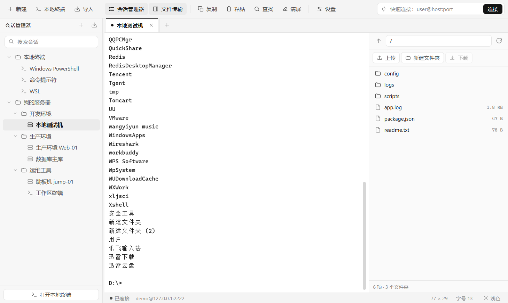
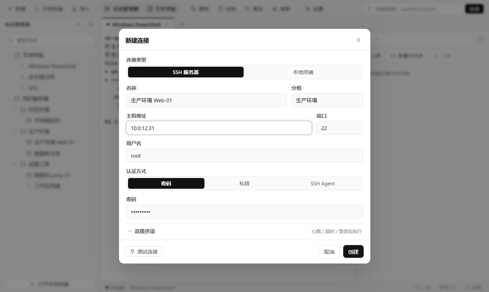
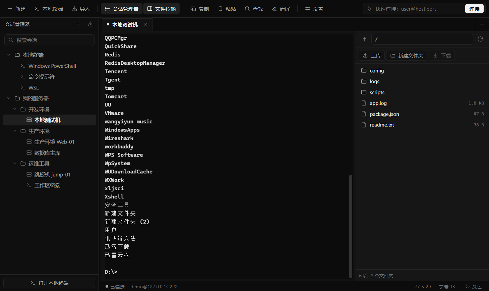
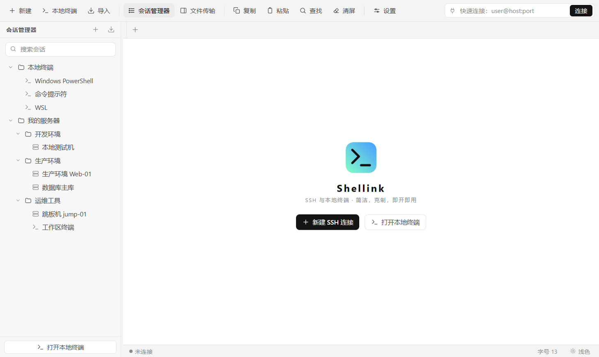

# Shellink

[](https://github.com/mete09/shellink/stargazers)
[](https://gitee.com/mete-ns/shellink/stargazers)
[](LICENSE)

**Windows 10 / 11（x64）** · **MIT License** · **v1.0.0**

一个面向 Windows 的 **SSH / 本地终端连接工具**：**纯黑白极简界面 + Xshell 式布局**，开箱即用，支持多标签、会话管理器、SFTP 文件面板、明暗双主题与 `shlnk` 命令行。

| 平台 | 仓库地址 |
| --- | --- |
| GitHub（主仓库） | https://github.com/mete09/shellink |
| Gitee（国内镜像） | https://gitee.com/mete-ns/shellink |

> 技术路线参照 GitHub 上 star 最高的开源终端客户端 **electerm**（15.5k★，MIT）与 **Tabby**（75k★，MIT）：
> 同为 `Electron + xterm.js + ssh2 + node-pty` 架构。本仓库按同一套核心依赖重新实现了一个**更精简**
> 的版本（主进程约 900 行、渲染层约 1800 行，无 React/打包器），并补齐了原项目中分散在多个模块的能力。



## 下载

**最新版本 v1.0.0** → [GitHub Releases](https://github.com/mete09/shellink/releases/tag/v1.0.0) · [Gitee 发行版](https://gitee.com/mete-ns/shellink/releases/tag/v1.0.0)

| 版本 | 体积 | GitHub 下载 | Gitee 下载（国内） | 说明 |
| --- | --- | --- | --- | --- |
| **安装版** | 92 MB | [`Shellink-Setup-1.0.0.exe`](https://github.com/mete09/shellink/releases/download/v1.0.0/Shellink-Setup-1.0.0.exe) | [`Shellink-Setup-1.0.0.exe`](https://gitee.com/mete-ns/shellink/releases/download/v1.0.0/Shellink-Setup-1.0.0.exe) | 可选安装目录、免管理员权限、创建快捷方式、自动注册 `shlnk` 命令 |
| **绿色版** | 92 MB | [`Shellink-Portable-1.0.0.exe`](https://github.com/mete09/shellink/releases/download/v1.0.0/Shellink-Portable-1.0.0.exe) | [`Shellink-Portable-1.0.0.exe`](https://gitee.com/mete-ns/shellink/releases/download/v1.0.0/Shellink-Portable-1.0.0.exe) | 双击即用，不写注册表、不建快捷方式 |

> 两个平台都是**单个完整 exe，直接下载双击即可**，无需解压、无需分卷。
>
> 未做代码签名，首次运行时 Windows SmartScreen 可能提示「未知发布者」，点「更多信息 → 仍要运行」即可。

## 关于「基于开源代码」

调研结论（2026-11）：

| 项目 | Star | 语言 | 许可证 | 作为二次开发基座的可行性 |
| --- | --- | --- | --- | --- |
| Eugeny/tabby | 75.2k | TypeScript | MIT | 功能最全，但 Angular + 插件体系 + lerna 单仓，构建链极重 |
| kingToolbox/WindTerm | 32.6k | C++/Qt | 自有许可 | Windows 下需 Qt 工具链，二次开发成本最高 |
| **electerm/electerm** | **15.5k** | **JavaScript** | **MIT** | **Electron + xterm.js + ssh2，模块划分清晰，最适合作为参考** |

因此本项目以 electerm 的会话层设计为参考（`TerminalBase` 派生 `TerminalSsh` / `TerminalLocal`，
渲染层 xterm 通过 IPC 与主进程收发数据），重新写成了单文件会话层
（[`src/main/session.js`](src/main/session.js)），并额外实现了：交互式认证弹窗、
主机指纹上报、SFTP 递归传输与进度事件。代码为本仓库原创实现，未直接复制上游源文件。

## 界面布局（参考 Xshell）

- **原生菜单栏**：文件 / 编辑 / 查看 / 工具 / 帮助，快捷键与工具栏一致
- **顶部工具栏**：新建、本地终端、导入 ｜ 会话管理器、文件传输 ｜ 复制、粘贴、查找、清屏 ｜ 设置，右端为「快速连接」输入框（`user@host:port` 回车直连，弹出密码框）
- **左侧会话管理器**：树形结构 —— 本地终端 / 我的服务器 → 分组 → 会话，支持折叠、搜索、右键菜单（打开 / 编辑属性 / 创建副本 / 删除），分隔条可拖动改宽度
- **标签页**：会话标签 + 新建按钮，中键关闭、`Ctrl+Tab` 切换
- **右侧文件传输**：SFTP 面板，可随时开关
- **底部状态栏**：连接状态、主机、行列数、字号、主题

## 功能

**连接管理**
- 保存/编辑/复制/删除 SSH 连接，支持分组折叠、实时搜索
- 密码、私钥（文件或粘贴内容 + 私钥口令）、SSH Agent 三种认证方式
- 密码与口令通过 **Windows DPAPI**（Electron `safeStorage`）加密后落盘
- 从 `~/.ssh/config` 一键导入主机（解析 `HostName/User/Port/IdentityFile` 与 `Host *` 默认值）
- 连接配置导入/导出 JSON
- 「测试连接」按钮，保存前先验证主机、认证与会话通道

**终端**
- 默认 **单色输出**（与界面同一套黑白灰层次），设置里可切回彩色
- xterm.js：256 色、点击链接、`Ctrl+F` 搜索、自定义字号
- 多标签页，`Ctrl+Tab` 切换、中键关闭、断线自动重连（最多 10 次）
- 复制粘贴（`Ctrl+Shift+C/V`、右键菜单、选中复制可选）、清屏、字号缩放
- 行列数随窗口自适应，状态栏实时显示
- 明/暗双主题，终端配色与 UI 同步切换
- 登录后自动执行命令（如 `cd /var/log && tail -f app.log`）

**本地终端**
- 自动探测 PowerShell 7 / Windows PowerShell / CMD / Git Bash / WSL，一键开新标签
- 真实 PTY（ConPTY），支持 `vim`、`top` 等全屏程序与 ANSI 颜色

**SFTP 文件面板**
- 目录浏览、路径直达、双击进入、下载/上传（递归）、新建文件夹、重命名、删除
- 传输进度条与百分比，失败原因友好提示

**交互细节**
- 主机密钥指纹在连接后记录并展示（`SHA256:...`）
- 连接错误做中文归一化：拒绝连接 / 域名解析失败 / 超时 / 认证失败 / 私钥口令缺失 等
- 窗口尺寸、主题、字号、面板状态持久化

## 设计

- **纯黑白**：不使用任何色相，只用 `#000 → #fff` 的灰阶层次建立信息层级；主操作是「黑底白字」实心按钮，次操作是细边框幽灵按钮。
- **发丝级边界**：`1px` 浅灰描边 + 极弱阴影，除分隔必要外不画任何装饰线。
- **单一强调方式**：不靠颜色区分状态，改用实心/空心圆点、字重与灰度深浅表达「已连接 / 连接中 / 失败」。
- **终端同源**：终端配色也是灰阶（16 色全部映射到黑—灰—白），需要分辨日志级别时可在设置中开启「彩色输出」。
- 明暗两套主题共用同一套结构，只切换灰阶方向（浅色以黑为强调，深色以白为强调）。

## 截图

| 主界面 | 新建连接 | 深色主题 | 空状态 |
| --- | --- | --- | --- |
|  |  |  |  |

## 命令行 shlnk

安装时会把安装目录加入当前用户 `PATH`，装完即可在任意终端里用：

```bash
shlnk                          # 打开 Shellink
shlnk root@10.0.0.11:2222      # 直接连接（首次会弹出密码框）
shlnk --local                  # 打开本地终端
shlnk --version                # 版本号
shlnk --help                   # 帮助
```

`shlnk` 是安装目录下的一个 `shlnk.cmd` 转发脚本，GUI 程序本身解析 `--connect / --local`
参数；已经打开的窗口会复用（单实例），在新窗口里按参数直接开会话。

## 安装

- 默认装到当前用户目录（`%LOCALAPPDATA%\Programs\Shellink`），**不弹 UAC、不需要管理员权限**。
- 想换盘就在「选择安装位置」里直接选盘符根目录（如 `D:\`）：安装器会**自动补上 `Shellink` 目录**，不用手动新建文件夹；选子目录（如 `D:\Tools`）同样会自动补成 `D:\Tools\Shellink`。
- 安装程序会创建开始菜单与桌面快捷方式，并把安装目录写入当前用户 `PATH`（卸载时自动移除）。
- 静默安装：`Shellink-Setup-1.0.0.exe /S /D=D:\Shellink`；覆盖安装沿用上一次的目录。

## 快速开始

```bash
npm install          # 安装依赖（Electron 已配置国内镜像时可加 ELECTRON_MIRROR）
npm start            # 开发模式启动
npm run build        # 打包 Windows 安装版 + 绿色版（输出到 release/）
```

打包产物：

- `release/Shellink-Setup-1.0.0.exe` —— NSIS 安装程序（可选安装目录、免管理员、创建快捷方式、注册 `shlnk` 命令）
- `release/Shellink-Portable-1.0.0.exe` —— 免安装绿色版

## 关于

菜单「帮助 → 关于 Shellink」只展示软件名、版本号与开发者：**Mete**。

## 目录结构

```
src/
├── main/                    Electron 主进程
│   ├── main.js              窗口、菜单、IPC 注册、会话事件桥接
│   ├── session.js           本地 PTY 会话 + SSH 会话 + SFTP 操作
│   ├── store.js             配置持久化与 DPAPI 加密
│   ├── shells.js            本地 Shell 探测
│   └── ssh-config-import.js ~/.ssh/config 解析
├── preload/preload.js       contextBridge 白名单 API
└── renderer/                渲染层（原生 JS，无打包器）
    ├── index.html
    ├── styles.css           设计变量 + 明暗主题
    ├── vendor/              xterm.js 及其插件的 UMD 构建（由脚本拷贝）
    └── js/{app,term,sftp,editor,ui,icons}.js
test/                        本地 SSH/SFTP 测试服务器与回归脚本
scripts/                     图标生成（logo.jpg → ico/png）、xterm 资源拷贝、shlnk 命令生成
build/                       installer.nsh（NSIS 自定义）、cli-path.ps1（PATH 注册）、after-pack.js（裁剪）、图标
```

## 实现要点

**进程模型**：渲染进程无 Node 权限（`contextIsolation: true`、`nodeIntegration: false`）；
终端数据流为 `pseudo-terminal / SSH channel → 主进程 Buffer → IPC → xterm.write()`，
输入反向走 `xterm.onData → IPC → pty.write / stream.write`。约 120ms 批量写入无节流，
实测大文件 `cat` 输出不掉帧。

**会话状态机**：`connecting → connected → closed/error`。为规避「会话先于渲染层就绪」的竞态，
主进程先完成事件桥接再 `session.start()`，渲染层对未匹配到标签的输出/状态做缓冲，拿到
`sessionId` 后回放。

**认证**：`keyboard-interactive` 交给渲染层弹窗输入（验证码/二次认证），不会阻塞主进程；
私钥支持内容或路径，`~` 自动展开。

**安全**：密码字段只在内存中为明文，落盘前转为 DPAPI 密文（机器/用户绑定，换机不可解）；
主机指纹记录但默认不强制校验（与多数 GUI 客户端首次信任的行为一致）。

## 自测

仓库自带一个本地 SSH/SFTP 服务器（`test/ssh-test-server.js`，账号 `demo/demo123`，端口 2222），
用于在没有真实服务器时做端到端验证：

```bash
node test/ssh-test-server.js     # 终端 A
node test/ssh-client-test.js     # 终端 B：连接 / 认证 / shell / 收发 / 关闭
node test/sftp-client-test.js    # 终端 B：列目录 / 下载 / 上传 / 建目录 / 重命名 / 删除
```

两个脚本共 15 项断言，当前全部通过。

## 已知限制

- 暂不支持端口转发、跳板机（ProxyJump）、串口、Telnet
- 单窗口；不支持分屏
- 主机指纹仅记录展示，未做 `known_hosts` 强校验
- 仅提供 Windows 打包配置（代码本身跨平台，`shells.js` 需按平台补充探测逻辑）
- `shlnk` 依赖安装时写入的用户 `PATH`，若被其他工具覆盖，重新运行安装包即可恢复

## 致谢与许可

本项目 MIT 许可。设计参考与依赖：

- [electerm](https://github.com/electerm/electerm) （MIT）—— 会话分层与 SSH 参数处理思路
- [Tabby](https://github.com/Eugeny/tabby) （MIT）—— 交互与功能取舍参考
- [xterm.js](https://github.com/xtermjs/xterm.js) （MIT）、[ssh2](https://github.com/mscdex/ssh2) （MIT）、
  [@lydell/node-pty](https://github.com/lydell/node-pty) （MIT）、[Electron](https://github.com/electron/electron) （MIT）
